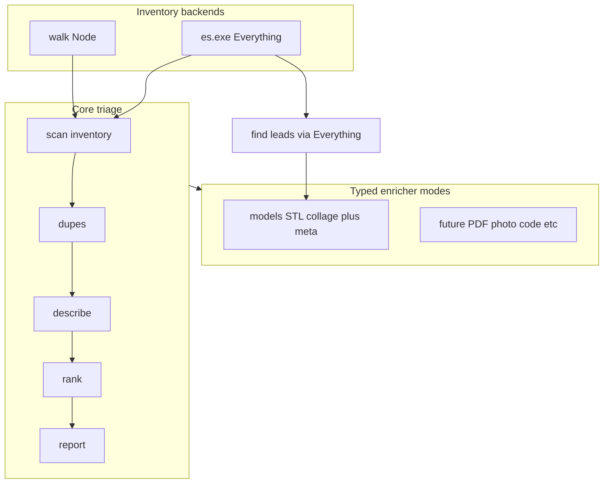

> Historical Sifter design (August 2026). The current product is ArchiveTuna. See [the README](../README.md), [current guide](guide/getting-started.md), and [release contract](RELEASE.md). These proposals are not a command reference.

# Sifter — product & architecture spec (v2)

*Living engineering spec for `z:\workspace\sifter`, 2026-08-03.
Supersedes the CLI story implied by bare-path STL defaults. Corpus-side
origin draft: `what-over-how/drafts/sifter-spec.md` (2026-08-01).
Everything Stage-0 detail: [`everything-backend.md`](everything-backend.md).*

---

## 1. Problem and outcome

**Problem.** Old personal archives hold private material mixed with the
work worth rescuing. Pointing a cloud agent at a raw tree is unsafe;
manual survey does not scale.

**Outcome.** A trusted **local** agent surveys the tree: maps structure,
detects duplicates/supersets, describes folders, ranks them against an
owner profile, and can enrich specific file classes (starting with 3D
models). The owner reviews local reports. Nothing leaves the machine
unless the owner later chooses to export a curated allowlist.

**v2 scope:** 100% local. A future cloud handoff (reports / path
allowlists for a more powerful remote agent) is recorded only as a
boundary — not designed or built here.

---

## 2. Product shape: core + modes

Sifter is one CLI with two layers:

| Layer | Job |
| --- | --- |
| **Core triage** | Understand *folders*: inventory → dupes → describe → rank → report |
| **Typed enricher modes** | Find / inspect / meta *classes of files* (3D models first; more later) |

Modes may consume core outputs (manifest, lead lists) but are not the
default product. The README hero flow remains core triage.



### 2.1 Core triage (unchanged intent)

Five independently runnable, cached stages:

0. **Inventory** — folders + file metadata only (path, name, ext, size,
   mtime). Configurable prune list. No content.
1. **Dupes** — folder fingerprints (recursive name+size sets):
   `identical`, `superset`, `diverged`, `name-collision`. mtimes stored,
   never authoritative.
2. **Describe** — local LLM, 1–3 sentences per selected folder, evidence
   gated by privacy tier.
3. **Rank** — local LLM vs profile YAML (`statement`, `projects`,
   `topics`, `terms`): score, action (`review` / `skim` / `skip`),
   novelty flag.
4. **Report** — `report.md`, `dupes.md`, `novel.md`, `report.json` under
   `--out` (default `./sifter-out/`).

### 2.2 Mode: `models` (3D)

First enricher. Finds STL models under a root, renders a five-view
collage (`f3d` + ImageMagick → `<name>-collage.png`), then writes an
adjacent sidecar (`<name>.stl.yaml`) with machine facts plus optional
local vision description (Ollama). Skip-if-exists; safe to re-run.

This is **not** “the sifter command.” It is one mode among many that
Sifter will grow (PDFs, photos, code trees, etc.).

### 2.3 Lead search (`find`)

When Everything is available: query-shaped discovery without a full
tree walk (“every `.stl` under Z:”, profile terms, known filenames).
See [`everything-backend.md`](everything-backend.md) §4.1. Requires
`es.exe`; not a substitute for core `run`.

---

## 3. CLI contract

### 3.1 Target surface

```
# Core triage (default story)
sifter run <root> --profile <file.yaml> [--tier N] [--backend auto|es|walk]
sifter scan <root> [--backend auto|es|walk]
sifter dupes
sifter describe [--tier N]
sifter rank --profile <file.yaml>
sifter report
sifter status

# Lead search (Everything required)
sifter find --ext stl --under <path>
sifter find --name Reality.doc
sifter find --profile profiles/corpus.yaml --terms

# Typed enricher: 3D models
sifter models <dir>                 # collage then meta (usual models flow)
sifter models collage <stl|dir>     # collage only
sifter models meta <dir>            # sidecars only (--no-vision for facts)

# Flags (shared where relevant)
--out <dir>       core cache/reports (default ./sifter-out)
--tier <0-3>      privacy tier for describe/rank
--profile <file>  required for rank/run
--model <name>    Ollama model
--limit <n>       cap LLM / sidecar batch size
--backend auto|es|walk   Stage 0 inventory backend
--no-vision       models meta: facts only
--dry-run         preview reads / backend choice; no LLM / no writes that mutate archives
```

### 3.2 Breaking UX (correct the drift)

As of the collage convenience change, bare `sifter <dir>` incorrectly
runs the STL collage→meta pipeline. **v2 CLI must not do that.**

- Unknown first tokens → help.
- If the first token is an existing directory path, print a short hint:
  use `sifter run <dir> …` for triage, or `sifter models <dir>` for 3D.
- Top-level `sifter collage` / `sifter meta` become aliases or are
  removed in favor of `sifter models …` (implementation choice; user-
  facing docs use `models` only).

### 3.3 Stack

- Node 22+, TypeScript, ESM only, pnpm.
- Ollama on `localhost:11434` (default model configurable; currently
  `gemma4:12b`).
- Stage caches: JSON files under `--out` (v1 deviation from original
  SQLite plan; revisit later if manifests grow painful).
- Fingerprints: sha256 over sorted `relpath|size` keys (not BLAKE3).
- Dupes: same-name pairwise + global identical clusters (not global
  MinHash).
- Windows-first (long paths, drive roots, cloud mounts); walk backend
  stays portable.

---

## 4. Privacy and trust

### 4.1 Tiers (core describe/rank)

| Tier | Model may see |
| --- | --- |
| **T0** | Folder names / tree shape |
| **T1** (default) | + file names, sizes, extension histograms |
| **T2** | + sampled content from a few small text files per folder |
| **T3** | + full text of small text files under a size cap |

Hard boundary: only the evidence gatherer reads content, and only what
the tier allows. Binaries are never sampled as text.

### 4.2 Known gaps vs README (fix toward the docs)

| Claim | Current code | Target |
| --- | --- | --- |
| T3 distinct from T2 | Same sampling path | Raise/remove sample caps at T3 |
| `--dry-run` shows what would be read | Skips LLM only | Print evidence preview + which inventory backend would run |
| `report` rebuilds from caches | Stub (empty descriptions/rankings) | Load describe/rank caches for current settings |
| `dupes` alone writes `dupes.md` | Prints counts only | Persist analysis with report writers or a dedicated write |

### 4.3 Models mode trust surface

Separate from T0–T3. Documented explicitly:

- **Collage:** local `f3d` reads the STL; ImageMagick writes adjacent PNG.
- **Meta + vision:** collage PNG (base64) + filename/path clues → local
  Ollama vision; sidecar written adjacent. Human `notes` block is never
  model-owned.
- Still **nothing leaves the machine**. Vision is not “tier T1”; it is a
  deliberate local inspect path for that enricher.

### 4.4 Future cloud boundary (non-goal for v2)

The only artifacts *designed* to ever leave the machine later are
owner-reviewed reports and explicit path allowlists. No automatic upload.
Format TBD when handoff is scheduled.

---

## 5. Everything integration

Official accelerator plan: [`everything-backend.md`](everything-backend.md).

Summary:

| Milestone | Deliverable |
| --- | --- |
| **M1** | `--backend es` Stage 0 → compatible `manifest.json`; walk fallback |
| **M2** | `sifter find` lead lists |
| **M3** | Models targeting via es query + profile prefilter before describe |
| **M4** | Incremental rescan via USN-backed diffs |

Rules:

- `walk` remains default/fallback (Linux/macOS, unindexed volumes, CI).
- Only `find` *requires* Everything.
- No content indexing through Everything; privacy tiers unchanged.
- Do not bundle `es.exe`; detect installed copy (`SIFTER_ES` / PATH /
  Program Files).
- Record `backend: "es" | "walk"` on the manifest.

---

## 6. Enricher contract (extensibility)

Typed modes share a thin contract (spec only until a second mode lands):

```
Enricher {
  id: string                          // "models" | "docs" | "photos" | …
  discover(root | query) -> File[]    // walk and/or es
  inspect(file) -> Artifact?          // collage, thumbnail, extract…
  meta(file) -> Sidecar               // adjacent YAML + optional local LLM
}
```

Conventions:

- **Skip-if-exists** for inspect and meta (incremental).
- **Adjacent-by-default** artifacts next to the source file.
- **Sidecar naming:** `<basename>.<ext>.yaml` (today: `part.stl.yaml`).
- **Resumable / failure-tolerant:** log and continue; retry next run.
- Core `--out` is for triage caches/reports; enrichers do not dump
  thousands of PNGs into `sifter-out/` unless `--out` is passed for a
  single-file override.

**v2 implements only `models`.** Future examples (not scheduled):

- `docs` — PDF/DOCX text extract + summary sidecars
- `photos` — contact-sheet / caption sidecars
- `code` — language histogram + README-aware folder meta

---

## 7. Data model and artifacts

### 7.1 Core (existing)

- `Manifest` — `root`, `scannedAt`, `tier`, `dirs[]`, `files[]`
- `DirStats` — counts, size, fingerprint, childKeys
- `DupePair` / `IdenticalCluster`
- `Description`, `Ranking`, `Profile`

### 7.2 Additions

- `Manifest.backend`: `"walk" | "es"`
- Find output: e.g. `leads.md` / `leads.json` under `--out` (grouped by
  parent folder)
- Enricher sidecars adjacent to sources; schema versioning field TBD
  (`schema: models/1` or similar)

### 7.3 Outputs

| Artifact | Where |
| --- | --- |
| `manifest.json`, stage caches, reports | `--out` / `./sifter-out/` |
| `<name>-collage.png`, `<name>.stl.yaml` | adjacent to STL |
| Lead lists | `--out` |

---

## 8. Implementation status (honest)

| Area | Status |
| --- | --- |
| Core scan / dupes / describe / rank / report writers | Implemented |
| Profile-driven `run` | Implemented |
| Privacy T0–T2 evidence | Implemented |
| Privacy T3 distinct behavior | **Gap** |
| Real `--dry-run` evidence preview | **Gap** |
| `report` from caches | **Gap** (stub) |
| JSON caches (not SQLite) | Intentional v1 deviation |
| sha256 fingerprints / same-name pairwise | Intentional v1 deviation |
| Models collage + meta (TS) | Implemented (`collage` / `meta` subcommands) |
| `sifter models` naming + bare-path fix | **Spec target** (CLI drift today) |
| Everything Stage 0 / `find` | **Specified**, not implemented |
| Enricher plugin interface in code | **Spec only** |
| Cloud handoff export | **Future**, out of scope |

---

## 9. Non-goals (v2)

- Moving, renaming, or deleting archive files (read-only toward sources;
  writes only to `--out` and enricher sidecars/collages the owner asked for)
- Cloud APIs, automatic upload, or shipping private trees to remote agents
- GUI
- Bundling Everything, f3d, or ImageMagick
- OCR / general image understanding outside an explicit enricher
- Requiring Everything for triage

---

## 10. Acceptance (directional)

**Core.** At T1 with the corpus profile against a known archive (e.g.
`E:\archives\old-workspace`), identical-cluster counts stay in the
previously measured ballpark; framework scratch ranks low; named
projects and novelty candidates surface in the report in a way that
matches owner intuition.

**Models.** `sifter models <dir>` (target CLI) produces collages and
sidecars for STLs lacking them; re-run is a no-op for existing outputs;
vision failures do not block later retries.

**Everything M1.** `sifter scan <root> --backend es` matches walk file
count/bytes within tolerance on an indexed NTFS fixture; `dupes`
consumes either manifest unchanged. Detail checklist:
[`everything-backend.md`](everything-backend.md) §9.

---

## 11. Open questions

| # | Question | Notes |
| --- | --- | --- |
| 1 | Sidecar schema versioning across enrichers | Defer until second mode |
| 2 | Can a profile select/enable enrichers? | Nice-to-have; manual CLI is enough for now |
| 3 | Revisit SQLite vs JSON caches | Only if stage caches or manifests become painful |
| 4 | Keep `collage`/`meta` as hidden aliases under `models`? | Prefer `models` in docs; aliases OK briefly |
| 5 | Cloud handoff package shape | Defer entirely until local survey is trusted |

---

## 12. Related docs

- [`README.md`](../README.md) — operator-facing overview
- [`everything-backend.md`](everything-backend.md) — es.exe Stage 0 + find
- `profiles/corpus.yaml` — worked ranking profile
- Corpus origin draft: `what-over-how/drafts/sifter-spec.md`
- Rescue-process context: `what-over-how/drafts/the-rescue-process.md`
