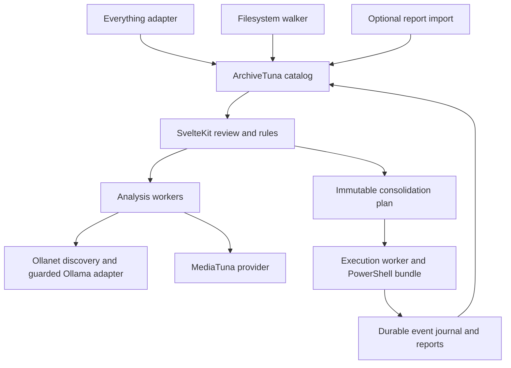

# ArchiveTuna consolidation workspace

**Spec kind:** Delivery  
**Status:** Draft for review; implementation has not started  
**Date:** 2026-10-28  
**Scope:** New capabilities in the existing ArchiveTuna project  
**Related:** [Integration contracts](archive-consolidation-integrations.md), [backlog](../TODO.md), [decision and session records](../appledger/README.md)

## 1. Problem and outcome

Personal archives spread across drives, synced storage, inboxes, old backups, and organized folders. A duplicate list identifies repeated files but rarely explains which copy belongs, whether a folder contains unique material, or how to consolidate files without losing their context.

ArchiveTuna will provide a local SvelteKit workspace to inventory these locations, review duplicate and folder relationships, classify material using selected local models, and plan moves and redundant-copy removal. It will generate and run inspectable PowerShell execution bundles and retain a searchable record of what happened and where surviving files live.

The product must remain useful without a model, Everything, or MediaTuna. Those integrations add discovery speed and richer understanding. This is an extension of ArchiveTuna; no separate deduper application or dependency on a particular personal report folder is planned.

## 2. Requirements and decision status

### Agreed product direction

| ID | Requirement |
| --- | --- |
| R1 | Build within ArchiveTuna, with a SvelteKit interface and an open-source audience. |
| R2 | Consolidate files into configurable trusted destinations; support keep, move, redundant-copy removal, and defer decisions. |
| R3 | Use Everything as the preferred inventory and duplicate-discovery source on supported Windows installations. |
| R4 | Use local models through Ollama and Ollanet discovery for classification and organizational suggestions. |
| R5 | Expose MediaTuna media capabilities through a reusable provider contract, with MCP access to the same operations. |
| R6 | Generate and execute reviewable shell scripts with detailed reporting, logging, and interrupted-run recovery. |
| R7 | Preserve review progress and organizational preferences across sessions. |

The user will describe their actual trusted folders and preferences later. This spec contains fictional examples only. It does not assume which locations are authoritative or which copies are intentional backups.

### Proposed implementation choices

These are recommendations for review, not claims of owner approval or shipped behavior:

- Add `apps/archive-desk/` using SvelteKit, TypeScript, and a Node server. Keep the existing root CLI/package and FilePress site. Preserve Node >=22 and the repository's pnpm version policy; validate the exact runtime/driver combination in M0.
- Store the new workspace catalog and decisions in local SQLite, with versioned migrations; use JSON for exchange and JSONL for execution events. Choose and test the SQLite driver in M0. Keep the database on local storage, outside scanned roots and cloud-sync directories.
- Start with a browser UI bound to loopback. A desktop wrapper is a later packaging choice.
- Make quarantine the initial proposed redundant-copy removal mode. The user has not selected a removal policy. M3 offers a supported reversible policy (quarantine, or a separately verified Recycle Bin implementation); permanent deletion/purge requires a future scope change. M3 real-file execution requires the reversible-policy choice; M1/M2 review work does not.
- Use a small versioned MediaTuna provider contract and a local subprocess adapter first; add MCP over that contract. No general plugin marketplace is required.
- Keep cloud inference outside this delivery scope. Unsupported or unavailable local models pause affected work; no automatic cloud fallback.

### Non-goals for this delivery

Hosted accounts, a public file server, shared multi-user editing, continuous autonomous cleanup, model training from corrections, arbitrary third-party plugin installation, automatic system-wide scans, and permanent erasure are outside scope. Perceptual similarity can inform review later; it never proves byte identity. Audio/video transcoding remains MediaTuna's responsibility and is a follow-on integration after read-only enrichment.

## 3. Existing behavior and compatibility

Source inspected on 2026-10-28; these observations are about the checkout, not a claim about the latest published package.

| Existing surface | Reuse and required extension |
| --- | --- |
| [Inventory](../src/inventory.ts), [types](../src/types.ts) | Current snapshots have one root and a filesystem walker. Add a separate versioned multi-root catalog; do not reinterpret legacy manifests. |
| [Duplicate analysis](../src/dupes.ts) | Folder fingerprints hash relative paths and sizes, not file bytes. Keep them as metadata candidates; add verified content groups. |
| [Evidence](../src/evidence.ts), [stages](../src/stages.ts) | Reuse bounded evidence, saved analysis, and cache principles. Destination suggestions and file-level classification are new operations. |
| [Ollama boundary](../src/ollama.ts) | Current inference accepts loopback endpoints and rejects known cloud-backed models/redirects. Trusted remote machines are an explicit extension. |
| [Everything design](../docs/everything-backend.md) | Historical proposal; no implemented Everything inventory backend. This spec governs the new integration. |
| [Current workflow](../docs/guide/workflow.md) | Existing scan/dupes/describe/rank/report commands leave originals untouched. Preserve those semantics. |

Existing CLI outputs, privacy tiers, STL behavior, and release packaging remain compatible. New mutation-capable commands must live under an explicit consolidation command group. Update product claims when that workflow ships, distinguishing analysis from execution. The site under `site/` must never acquire access to user files or become the runtime for the local utility.

## 4. User journey and interface

### Primary journey

1. Create a local workspace and select source roots. Mark trusted destinations, protected locations, intentional backups, and exclusions. A destination may also be a source.
2. Check discovery coverage. Use Everything where supported; offer the filesystem walker for unsupported/unindexed roots. Show inaccessible, excluded, stale, or incomplete areas explicitly.
3. Review files and folder overlap. Start with high-impact candidates by redundant logical bytes, copy count, or location. Name/size candidates and verified content groups have different badges.
4. Optionally enrich selected items through a chosen model or MediaTuna provider. Review evidence, explanations, uncertain outcomes, and proposed destinations.
5. Record decisions individually or through previewed rules. Repeated corrections become explicit reusable preferences, with precedence and scope visible.
6. Build a frozen plan containing exact sources, destinations, surviving copies, preconditions, dependencies, and the removal policy. Preview conflicts, required content reads, and disk requirements.
7. Review the plan and execution bundle, then authorize that exact revision. Run through the app or invoke the exported script manually.
8. Review results, resolve blocked steps, refresh the catalog, and locate any file through its original or current path. Resume or build a compensating recovery plan where supported.

Example: select `D:\Inbox\Trip\photo.jpg` as the preferred copy, place it in `E:\Library\Photos\Trip\photo.jpg`, verify the destination, then quarantine two redundant copies. The plan retains the provenance of every path and the evidence behind each decision.

### Screens

| Screen | Required behavior |
| --- | --- |
| Workspace | Root roles, exclusions, backend health, coverage, model/provider availability, data directory. |
| Review | Virtualized/paginated group list, type/folder/status filters, visible full paths, size and evidence badges, preview pane, saved selections. |
| Folder comparison | Shared content, content unique to each side, unverified items, and overlap denominator/coverage. A duplicate report alone cannot establish that a folder is empty of unique files. |
| Decision detail | Facts, model suggestions, and human decisions displayed separately; keeper/destination rationale and rule provenance. |
| Rules | Scoped path/type/category rules, trusted-root priority, protected backups, previewed affected items, conflicts, enable/disable, revision history. |
| Plan | Ordered operations, unchanged keepers, collisions, estimated transfer/storage impact, blocked reasons, export and execute controls. |
| Jobs and history | Progress, pause/cancel state, restart reconciliation, per-file events, failures/skips, recovery actions, searchable old/new paths. |

Bulk actions apply to an explicit saved set and show the count before confirmation. Rule precedence is: protection/exclusions, explicit per-file decisions, user-defined ordered rules, then model suggestions. Contradictory rules block the affected items. A model's numeric confidence is a self-reported signal, not calibrated certainty.

Review works with zero results, absent optional integrations, disconnected roots, partial scans, stale evidence, and interrupted jobs. Keyboard navigation, labeled controls, non-color status labels, accessible focus management, and progress announcements are required. Browser refresh must not abandon jobs or lose decisions; concurrent tabs use revision checks.

## 5. Architecture and state



UI/server handlers validate requests and enqueue work. Discovery, hashing, inference, and file operations run outside HTTP request lifetimes. A coordinator on the execution machine serializes conflicting mutations across all workspaces, browser sessions, CLI invocations, and exported bundles. Locks cover every affected source, survivor, and destination namespace, keyed by resolved volume/file identity where supported, with alias/path reservations for nonexistent destinations. A workspace-only lock is insufficient: two workspaces must not designate opposite survivors and remove both copies. Independent read jobs have bounded concurrency. A worker restart reconciles persisted jobs, ownership locks, and on-disk evidence before scheduling more mutations.

Initial destructive execution is supported only where the coordinator and filesystem can enforce the required identity/locking guarantees. Shared/network roots or execution from multiple machines require cross-machine coordination; when that guarantee is unavailable, permit analysis and block destructive execution. External non-ArchiveTuna writers are handled through the operation-level checks below, not presumed cooperative.

The local browser is not a security boundary. Bind to loopback; validate Host and Origin; require a per-session token for sensitive routes; serve only cataloged, authorized files by opaque ID. Preview extraction treats content as untrusted, caps resources, and never executes active document content. Requests cannot select arbitrary executables, raw shell commands, or filesystem paths outside authorized roots. Model/provider calls are server-side only.

### Data model

| Entity | Required information and invariant |
| --- | --- |
| Workspace | Schema version, roots and roles, exclusions, coverage policy, preferences, model/provider policy, revisions. |
| Root / snapshot | Stable ID, machine/volume identity where available, display path, backend/version/instance, query scope, scan times, counts, errors, completion/coverage status. |
| File observation | Stable catalog ID; root-relative and original display paths; size, times, attributes, availability; platform identity/link count where available; observed version. Paths alone are not file identity. |
| Content record | Algorithm, digest, byte size, verification time, file version before/after read, verifier/version, stream scope. Missing/failed hashes remain unknown. |
| Duplicate group | Members and evidence level: imported, metadata candidate, or content verified. Stable group identity derived from current content membership. |
| Enrichment | Content-derived facts separate from path/folder interpretation; model/provider/version, prompt/schema revision, evidence digest, policy, result, uncertainty, human overrides. |
| Decision / rule | Actor, reason, scope, revision, applicable file versions, keeper/destination, precedence, timestamp, dependencies. |
| Plan / operation | Plan revision/digest, schema and runner version, operation ID/kind, source/destination IDs and paths, expected versions/hashes, authorization, dependencies, recovery policy. |
| Job / event / artifact | Job ID, state, sequence, attempts, timestamps, structured progress/results, manifest/log/report hashes, event journal location. |

Normalize paths for comparison according to actual filesystem semantics while preserving their display form. Deduplicate overlapping roots and aliases; record hard links as multiple names for shared storage. Do not count hard-link aliases as independent recoverable bytes. Detect volume replacement/remounts and reconcile renamed files without equating an unrelated file at the old path.

Migrations preserve original observations and decision history. Back up before schema upgrades; reject unknown newer formats without modifying them. Keep the workspace DB and job journal on local storage; source files may be remote. Workspace export is explicit and explains that paths, previews, and extracted text may be included. Public fixtures and examples must be synthetic.

### API sketch (proposed)

Use versioned JSON contracts for root registration, inventory jobs, paginated files/groups, enrichment jobs, revision-checked decisions/rules, plan creation/validation/authorization/export, execution, job events/cancel/resume, and history search. Route handlers cannot perform unjournaled mutations. Use a query endpoint for large result sets and resumable event delivery with sequence cursors. Filesystem paths, provider stderr, and model responses are data, never instructions or executable code.

Proposed CLI group: `archivetuna consolidate` with `inventory`, `verify`, `plan`, `validate`, `export`, `execute`, `status`, `resume`, and `recover` subcommands. Exact syntax is established in M0/M1; these commands do not exist today. Browser and CLI use the same services, plan schemas, and executor.

## 6. Discovery and duplicate semantics

Everything is the preferred Windows backend when its capability and coverage checks pass. Detect installed ES and Everything versions and instance; query only selected roots. Use bulk structured results, explicit fields and byte units, bounded streaming, and completeness checks. A result cap, timeout, parser error, permission error, or missing root makes the snapshot incomplete; zero results alone is not evidence of an empty folder.

Group candidate files by exact size across the selected scope without requiring matching filenames or extensions. Use native `dupe:size;sha256` only after verifying support and result completeness for the installed CLI/server combination. Otherwise hash same-size candidates with ArchiveTuna. Cache verified digests against observed versions and invalidate on changes. Hashing requires content reads; budget I/O and make cloud-placeholder hydration a separate, explicit policy.

Content verification must cover every candidate that could be removed, including same-name/same-size copies. Recheck that each read was stable. Matching main-stream digests do not prove equality of NTFS alternate streams, sidecars, permissions, or other preservation metadata. Surface those differences and block removal until the selected preservation policy can retain them. Unsupported metadata is an unresolved preservation condition, not a successful verification.

Metadata similarity, folder subsets, perceptual similarity, and derivative media are separate relationships. Folder overlap uses the full scoped inventory and shows coverage gaps; no bulk directory removal can be inferred from a candidate-only list. Empty-directory removal is outside the first execution milestone.

Auslogics XML remains an optional importer. Preserve report provenance and reported grouping, disable external entity/DTD processing, cap input size, and mark group reconstruction ambiguous when the format cannot establish boundaries. Rounded report sizes are display hints; obtain exact bytes from the filesystem. Imports contain only reported candidates and cannot establish complete source coverage.

See [integration contracts](archive-consolidation-integrations.md) for adapter capabilities, installed-version limitations, and provider schemas.

## 7. Local classification and organization

Manual review and content verification work without any model. Direct loopback Ollama remains supported. Ollanet supplies discovery and target resolution; a discovered endpoint requires explicit selection/trust before archive evidence is sent. Trusted source roots and trusted model hosts are independent settings.

Keep the existing evidence-tier defaults and bounds for folder descriptions. Add an explicit preview of file-level evidence, thumbnails, and text extraction before enabling richer analysis. Send only evidence permitted for the selected roots and task. LAN sweeps are opt-in; do not enumerate every reachable host merely by opening the app.

Persist the selected endpoint, model name/digest where available, capabilities, evidence policy, prompt/schema revision, and input identity with each job. Reject redirects and known cloud-backed models. Explain that self-hosted endpoint configuration is part of the trust decision; a private IP alone does not prove local inference. No fallback to a different host/model without a new explicit selection.

Classify identical bytes once where the result is content-only. Compute path/folder meaning separately so different locations, sidecars, and user preferences can produce different placement suggestions for the same bytes. Cache identity includes all relevant inputs and model/provider/rule revisions. Changed evidence or user notes invalidates dependent suggestions. Human corrections remain authoritative; rule extraction is a previewed action, not silent model retraining.

Parse and validate bounded structured results. Invalid output, unsupported vision/schema support, missing models, timeouts, and cancellation yield recoverable job states. Suggestions cannot run tools, alter roots, authorize plans, or become shell fragments. Keep uncertain cases reviewable without requiring an inference retry.

## 8. Consolidation plans, execution, and recovery

### Plan rules

- Decisions are editable; an authorized plan revision is immutable. Changes to operations, destinations, policy, or unexpected external observations create a new revision and invalidate prior authorization. Expected postconditions are part of the authorized dependency graph: an executor-produced, journal-verified move may establish the new survivor location/identity for dependent removals without reauthorizing every step. Only those exact expected transitions qualify. External replacement/drift blocks the affected chain. Validation immediately before execution can block a stale plan without rewriting it.
- Represent each placement and redundant-copy action explicitly. A designated survivor must remain outside the removal set for every verified group. Keep intentional backups protected, even when identical.
- Build a dependency graph: a move/verified placement that establishes a survivor completes before dependent removals. Reject cycles, overlapping conflicting paths, and cross-plan resource conflicts.
- Reserve destinations and detect existing content. Never overwrite a conflicting file silently. Offer retain-both naming, a user-selected destination, or review; an identical existing destination still needs preservation checks.
- Block attempts to move a directory into itself, path escapes, unapproved roots, or changes through symlink/junction traversal. Initial mutation scope is regular files; directory traversal and link handling are explicitly validated. Hard links require a link-aware decision.
- Show transfer bytes, temporary headroom, logical redundant bytes, quarantine bytes, and measured freed space separately. Sparse/compressed files and hard links prevent a simple sum of file sizes from proving physical savings.

### Execution bundle

Export `plan.json`, `run.ps1`, a runner/version requirement manifest, and a human-readable plan summary. Include hashes of the plan and generated script, operation IDs, explicit output/log location, and the exact execution policy. The PowerShell script invokes the versioned ArchiveTuna executor using literal arguments and the data manifest; it is inspectable and requires the documented installed runner. It is not advertised as dependency-free.

App execution runs the same generated bundle/runner path. Manual invocation presents the same plan digest and requires explicit confirmation for that revision, unless the trusted executor can resolve an unrevoked authorization in its protected local approval store. A receipt is a reference to that record, not authority derived from hashes in an editable bundle. Bind authorization to plan/script digests, runner identity/version, execution machine and workspace, selected root identities, removal/preservation policy, and a configured expiry. The user can revoke unused authority; stale preconditions or changed bindings block execution. A portable bundle without the matching trusted local record requires confirmation on the execution machine.

The app validates artifacts before launching; the trusted executor independently validates the manifest and authorization before mutation. Arbitrarily edited PowerShell executed outside that path is outside ArchiveTuna's guarantees; an embedded checksum cannot make hostile script edits safe. No automatic execution-policy weakening, privilege elevation, wildcard deletion, or shell-string interpolation. A generated script contains no model-authored commands. Logs go to an explicit durable workspace/bundle location and can be imported back by plan/job ID.

### Operation state machine

`planned -> preflighted -> intent-recorded -> applying -> applied -> verified -> committed`

Terminal/suspending outcomes include `skipped`, `blocked`, `failed`, `cancelled`, and `needs-reconciliation`. Persist and flush intent before mutation, then record outcomes after each step. A durable journal failure stops further mutations. Each event has a monotonically increasing sequence and stable operation/attempt IDs. Replaying events cannot itself repeat filesystem actions.

For same-volume renames, confirm source identity and destination absence, perform the supported atomic/no-overwrite operation, then reconcile identity and preservation metadata. For cross-volume moves, copy to a unique temporary destination, flush/close, verify all required content/metadata, finalize without overwrite, and only then remove the exact verified source. Keep recovery evidence for both locations. Free-space checks include temporary copies and quarantine requirements; failure leaves a recoverable state.

Before redundant-copy removal, establish a current, verified survivor and validate the candidate again. Use platform file-handle/locking facilities where available to bind checks to the affected object. If replacement, concurrent writes, destination drift, or an unsupported filesystem prevents a sufficient guarantee, block that operation. Testing only a path before a later mutation is insufficient. File-attribute timestamps alone are not deletion proof.

Quarantine uses a unique destination and records original path, identity, content, and preservation metadata. Cross-volume quarantine uses the same verified-copy rules. Quarantining on the same volume normally does not reclaim space. Recycle Bin and permanent deletion need separate platform capabilities and explicit policy decisions; no unavailable recycle action may fall back to permanent deletion. Purge is a separate later action.

Cancellation stops scheduling new operations; it does not interrupt an atomic mutation halfway through. Copy/hash cancellation closes resources, records temp artifacts, and retains the source. On restart, reconcile source, destination, temp files, journal state, and ownership locks before continuing. Never infer success merely because the source disappeared. Retries skip only operations whose postconditions are still proven.

Recovery creates a new reviewed compensating plan. Restore only where the original path is available or a new destination is chosen; never overwrite newer data. Record limits: recycle support varies, purged files cannot be recovered by the app, and cross-volume restoration requires available space. Do not promise universal undo.

## 9. Reporting and audit contract

For each run, retain the immutable plan, script and runner identity, authorization record, append-only JSONL events, machine-readable result summary, and readable report. Store exact source/destination/survivor references, observed versions, verification method/results, rule or human rationale, start/end times, attempts, bytes, errors, skips, and recovery availability. Record model provenance via linked enrichment IDs; raw file content need not be duplicated into operation logs.

Report counts and bytes by action and outcome, distinguish expected from measured savings, and show incomplete coverage. A partially successful run is never labeled complete. The UI and exported reports derive from the same events. Cross-volume moves and later recovery remain searchable through the entire path history. Checksums identify artifacts and accidental changes; an ordinary local journal is not tamper-proof.

Exclude personal catalogs, reports, previews, databases, and actual archive paths from repository fixtures and public examples. Workspace retention/export controls cover model caches and transcripts as well as execution logs. Logs required for unresolved recovery are not silently rotated away.

## 10. Delivery sequence

| Milestone | Outcome and exit condition |
| --- | --- |
| M0: contracts and fixtures | Validate installed Everything/ES capabilities on synthetic files; settle catalog driver, runtime, and UI distribution/launcher; agree schemas, mutation guarantees per filesystem, provider availability, and benchmark protocol. No real archive mutations. |
| M1: useful review | SvelteKit app, multi-root catalog, Everything + walker, exact verification, duplicate/folder review, saved keep/move/remove/defer intent, manual rules, plan preview and JSON export. Executable bundles and execution controls arrive in M3. |
| M2: local enrichment | Guarded Ollama/Ollanet targets, resumable classification and destination suggestions, evidence controls, MediaTuna probe/preview/import and result-only classification through the provider contract. Durable submit/status/events/cancel/reconcile and policy enforcement are provider prerequisites here. |
| M3: audited execution | Explicit removal policy, generated PowerShell bundle, shared executor, crash/retry/cancel/recovery semantics, reports, fixture fault injection, and operator-reviewed sample execution. |
| M4: interoperability and release | MediaTuna MCP wrapper over the M2 durable jobs, optional Auslogics import, fresh-install UI/CLI checks, compatibility docs, accessibility and performance checks. Conversion integration is separately scoped after these foundations. |

M1 can ship as a useful review tool. Execution is complete only after M3 acceptance; the overall feature is complete only when the scoped M4 work and all acceptance criteria pass. Optional integrations must not make unrelated manual review unavailable.

The UI needs an explicit distribution artifact. M0 chooses either inclusion of the built SvelteKit server/client assets in the root npm package or a separate installable app package, and documents its launcher (proposed `archivetuna desk` if bundled at the root). The existing npm allowlist does not include `apps/archive-desk`; the installed-package test must cover the chosen artifact and asset locations. Neither the local UI nor an integration may require a sibling source checkout after installation. Do not change the existing CLI package's public contract merely to satisfy an app packaging shortcut.

## 11. Verifier and acceptance criteria

### Verifier command

Existing repository regression command, runnable today:

```sh
pnpm test
```

Implementation must add new synthetic catalog/adapter/planner/executor tests to that suite. The existing suite alone does not verify this feature. At M1 add root `pnpm verify:consolidation` to run the root tests, Svelte checks/build, and the UI/worker fixtures. That command is a proposed deliverable, not an available command today. Keep actual Everything, Ollama, and filesystem-platform checks opt-in and report whether they ran.

### Required acceptance

- [ ] AC01: With no Everything, Ollama, Ollanet, or MediaTuna installed, a synthetic two-root workspace can be inventoried, verified, reviewed, and reopened with saved decisions through the walker.
- [ ] AC02: Everything and walker snapshots on a fixed supported fixture agree on scoped regular-file membership and exact sizes; omissions/errors/caps mark incomplete coverage and prevent a completeness claim.
- [ ] AC03: More than 50 identical files, changed extensions, Unicode/query punctuation, equal-size unequal bytes, and same-name copies are grouped correctly; every proposed removal is content verified.
- [ ] AC04: Overlapping roots and hard-link aliases do not inflate file or reclaimable-storage claims; inaccessible volumes and cloud placeholders are surfaced without automatic hydration.
- [ ] AC05: Folder comparison includes unique files omitted from an imported duplicate report and labels unknown coverage; no candidate-only input authorizes removal of a whole folder.
- [ ] AC06: Refresh/restart retains decisions; changed content, root identity, rules, or evidence invalidates dependent results/authorization. Concurrent tabs cannot silently overwrite decisions.
- [ ] AC07: A protected backup survives every rule preview and generated plan; contradictory rules, missing keepers, cycles, and destination collisions block affected operations.
- [ ] AC08: An untrusted discovered host receives no archive evidence. Known cloud models and redirects are rejected; offline/unsupported models do not trigger fallback. Manual review still works.
- [ ] AC09: Human corrections override machine output; content-only analysis can be reused for identical bytes while different folder context produces separate destination reasoning. Invalid model output never becomes a filesystem operation.
- [ ] AC10: MediaTuna enrichment writes only to the declared artifact directory, preserves original files and human sidecars, and returns validated artifact references. A provider lacking this capability is unavailable for that operation.
- [ ] AC11: Exported and in-app execution validate the same frozen manifest and script identity; stale/edited artifacts fail before mutation. Paths containing shell metacharacters are treated literally.
- [ ] AC12: Fault injection before/after every execution state, during copy, verification, finalization, source removal, and journal writes leaves a reconciled or explicitly blocked state; rerun never removes an unverified survivor or overwrites a destination. A move-then-remove graph continues on its verified expected postconditions, while external replacement between those steps blocks it.
- [ ] AC13: Cancellation/restart, locked files, full disks, disappeared roots, junction replacement, concurrent file writes, unsupported metadata, and permission failures produce accurate per-file outcomes and no silent weakening of checks.
- [ ] AC14: Quarantine recovery restores the intended verified file or reports a conflict. Purged/unrecoverable items are not presented as undoable. Logical, quarantined, copied, and measured freed bytes are separate.
- [ ] AC15: Every attempted mutation has a durable intent event and traceable result/reconciliation record; original-to-current path lookup and readable/JSON reports agree, including partial runs.
- [ ] AC16: MediaTuna's proposed machine CLI/provider/MCP with `artifacts-only` selected return equivalent validated semantics on a shared fixture; background jobs survive caller disconnect and expose progress, cancel, result retrieval, and restart reconciliation. Existing legacy photo commands retain their documented sidecar behavior.
- [ ] AC17: Existing ArchiveTuna CLI/package tests and installed-package smoke pass; ordinary analysis commands still leave originals untouched and legacy manifests remain readable through their existing commands. Install the prepared UI distribution artifact in a fresh directory, launch its local server/UI, create and reopen a fixture workspace, and use optional integrations without sibling source checkouts.
- [ ] AC18: A synthetic 100,000-file catalog is paginated/virtualized, with at most 200 list rows mounted and no full-file-content payload in catalog/list/filter responses or bulk preloads. Explicit previews use separately authorized, bounded content-type/size and streaming rules. Measure first-page/filter latency on a recorded reference machine; proposed p95 target is <=500 ms after catalog creation. Record hashing/model throughput separately; no universal speed claim.
- [ ] AC19: Keyboard-only review, focus restoration, labeled status/errors, and screen-reader progress work; root/preview/mutation APIs reject unauthorized paths, origins, tokens, and unsupported provider outputs.
- [ ] AC20: Concurrent plans from two workspaces and an exported bundle cannot remove one another's selected survivors or write the same destination. Unknown cross-machine coordination blocks destructive execution on shared roots. Forged, expired, revoked, wrong-machine, or edited-bundle receipts fail before mutation.

### Manual validation sequence

Use a disposable fixture with inbox/library/backup roots, intentional unique files, same bytes under different names/extensions, same-size unequal content, sidecars, and naming collisions. Compare backends, select a downloaded local model, review its evidence and corrections, preview a combined move/removal plan, export and inspect the bundle, execute on the fixture, interrupt at a controlled checkpoint, resume, recover one quarantined item, and reconcile reports with disk state. Repeat with integrations absent and with injected errors. Never use a personal archive as the mutation test fixture.

## 12. Open decisions

| Question | When it matters | Working treatment |
| --- | --- | --- |
| Which folders are trusted, protected, or intentional backups? | Before a real consolidation plan | User-supplied workspace configuration; synthetic examples in tests. |
| Which supported reversible removal policy? | Before M3 policy lock and real execution | Quarantine proposed; Recycle Bin needs verified platform support. Permanent deletion/purge is future scope, not an M3 alternative. |
| Required dates, ACLs, alternate streams, sidecars, and other preservation metadata? | Before M3 platform acceptance | Preserve supported metadata, surface differences, block unsupported removal. |
| May reading a cloud placeholder download its content? | Before content reads on those files | Skip/defer by default; show bounded hydration consent separately. |
| Browser-only release or packaged desktop app? | Before distribution work | Local SvelteKit/Node first; retain a future wrapper boundary. |
| Bundle the UI in the root package or publish a separate app package? | M0, before launcher/layout is locked | Explicit assets and launcher; fresh-install UI test, no source-checkout dependency. |
| Which SQLite driver and supported Node versions? | M0 | Validate local install, locking, migrations, backup, and packaging before locking. |
| Which models/hosts and MediaTuna capabilities are available? | M0/M2 | Detect capabilities and select trusted targets; never hard-code the owner's setup. |

The questions above do not prevent review of this spec or M0/M1 planning. Choices marked proposed require validation; implementation acceptance boxes remain unchecked until supported by evidence.

## Implementation summary

Not implemented. This document and its companion define the intended delivery. Move the spec to `specs/partial/` when code work begins and to `specs/completed/` only after recording implementation, verifier results, manual checks, and remaining limits.
